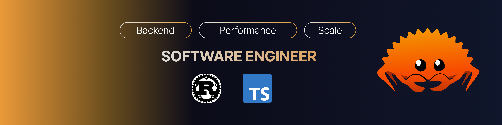

<h2>Hi, I'm Athithian 👋</h2>

  
  
  

Backend Engineer working with Rust to build high-performance, reliable, and scalable systems. My focus is on backend engineering, system design, API development, and database management. I also work with TypeScript and modern frontend technologies to build complete applications from backend infrastructure to user interfaces.

<h2 align="center">Some of my favorite projects</h2>
 

    
  

<h2 align="center">About me 🦀</h2>

<h3 align="center">Backend Engineer · Rust · TypeScript</h3>

🚀 At Outbox Labs, I’m part of a 25-member engineering team contributing to a business that manages over $50 million in revenue. I work on backend development and software that supports the company’s products and operations, where reliability, maintainability, and performance matter.  
🛠️ I built <a href="https://github.com/AthithianV/bullastrator">Bullastrator</a>, a native desktop application for managing, inspecting, and monitoring Redis and BullMQ queues. Built with Rust, Tauri, Svelte, and TypeScript, it brings queue management, job inspection, bulk operations, and real-time monitoring into one desktop experience.  
💡 I believe good engineering is about understanding problems, making thoughtful technical decisions, and building solutions that deliver real value. I continuously work on improving my engineering skills, exploring systems-level concepts, and building software that solves practical problems.  
📫 <b>Let's connect!</b> athithianpkt2001@gmail.com

 

<h2 align="center">⚒️ Languages-Frameworks-Tools ⚒️</h2>
 

  
   
  

 

  

  

